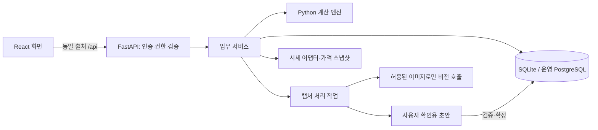

# RetireTogether — 컨셉 구현·구조·보안 검토

검토일: 2026-10-26. 대상: 현재 작업 트리의 코드·문서·테스트와 `assets/concept.jpg`.
상태: 2026-10-26 연구 결과. 2026-10-27 사용자가 개선안을 Claude의 작업에 반영하도록 승인했다. 현재 실행 계획·담당·인계 상태는 `AGENT_DESIGN.md` §0. 이 보고서 자체는 기술 전환 완료나 배포를 의미하지 않는다.

## 1. 판단

**컨셉에 가까운 제품 화면을 목표로 삼고, 프론트엔드는 React + TypeScript, 백엔드는 Python + FastAPI로 분리하는 것을 권한다.** Python 계산·태깅·전략 로직은 입력 검증과 회귀 테스트를 보강해 재사용한다. 현재 Streamlit 앱은 전환 중 결과를 비교하는 내부 도구로 둔다.

현재 문제의 핵심은 화면을 꾸밀 시간이 부족했다는 점보다 **개발 완료 기준이 컨셉과 다른 데 있다.** 요구사항은 ‘부부의 자산과 은퇴 계획을 한눈에 보는 서비스’인데, 실제 구현 범위는 ‘연금 리밸런싱 드라이런과 설정 화면’에 집중되어 있다. 두 작업은 서로 다른 완료 기준이 필요하다.

이전 체크리스트의 72%는 폐기해야 할 제품 완성도 지표다. 화면·기능·검증·실사용 준비를 구분하고, 컨셉을 옮긴 홈 화면을 첫 번째 검수 대상으로 삼는다.

사용 범위는 아직 최종 확정되지 않았다. 아래 기본안은 **로컬에서 완성 → 부부의 비공개 공유 → 필요하면 서비스화** 순서다. 처음부터 공개 서비스가 목표라면 인증·가구별 권한·운영 DB를 첫 실데이터 연결 단계로 앞당긴다.

## 2. 무엇을 확인했는가

- 컨셉 JPG를 직접 확인하고 화면 레퍼런스·PRD·PoC 설계와 비교했다.
- `app/`, `tools/`, `agent/`, 테스트, 저장 방식, 개발 설정을 검토했다.
- 기존 Python 3.9.6 환경에는 uv·프로젝트 가상환경·필수 라이브러리가 없었다. Node v24.19.0과 npm 11.17.0은 있었다.
- 승인받아 `/private/tmp` 아래에 uv 0.13.5와 Python 3.12.15를 설치하고, **기존 `uv.lock`을 변경하지 않고 `uv sync --locked --python 3.12`로 동기화**했다.
- 기존 테스트 실행 결과: **18 passed / 15 failed**. 실패 15개는 모두 `data/fixtures/holdings_fixture.csv` 부재로 발생했다. 계산 정확성이 15개 실패했다는 의미는 아니며, 해당 검증이 시작조차 되지 못한 상태다.
- 별도의 합성 입력으로 저장 경로·파싱·계산 경계 문제를 재현했다. 쓰기 검사는 임시 폴더 안에서만 진행했다. 실제 캡처를 LLM에 전송하거나 실제 주문을 실행하지 않았다.
- 브라우저의 실제 픽셀 스크린샷 비교는 수행하지 않았다. 화면 판단은 컨셉 이미지, 렌더링 코드, Streamlit AppTest에 근거한다. 실데이터·모바일 기기·운영 환경 검증은 남아 있다.
- 검토 중 다른 작업의 미커밋 변경이 있었으므로, 아래 줄 번호와 결과는 검토 시점의 작업 트리 기준이다. 기존 변경을 덮어쓰지 않았다.

## 3. 컨셉과 현재 구현의 차이

컨셉은 하나의 긴 웹페이지가 아니라 **브랜드 소개 + 데스크톱 앱 + 모바일 앱 + 기능 소개**를 한 장에 담은 이미지다. 중앙 데스크톱과 오른쪽 모바일을 같은 서비스의 반응형 화면으로 만들고, 왼쪽 사진·아래 기능 소개는 랜딩/소개 영역으로 취급하는 것이 자연스럽다. 부부 사진과 바다·노을의 분위기는 앱 머리글에도 반영한다.

| 컨셉 요소 | 현재 코드에서 확인한 상태 | 구현할 내용 |
|---|---|---|
| 네이비 사이드바, 로고, 가족 프로필 | 기본 Streamlit 라디오 메뉴와 이모지 | 공통 AppShell, 활성 메뉴, 아이콘, 하단 가족 프로필 |
| 사진과 인사말이 있는 머리글 | 제목·캡션 | 사진/배경, 인사말, 보기 전환, 알림을 한 영역에 배치 |
| 총자산·두 주머니 KPI 카드 | `st.metric` 3개, 데이터 없으면 샘플 | 카드 간격·숫자 계층·원형 비율·기준일·데이터 상태 |
| 자산 구성 도넛 + 범례 | 홈에 없음 | 서버 집계값을 쓰는 차트, 선택/툴팁, 표 대체 보기 |
| 은퇴 목표/가능 시점 | 홈에 없음 | 목표 나이와 예상 달성 시점을 구분, 미입력 상태 제공 |
| 전략별 자산배분 카드 | 홈에 없음 | 선택 전략과 비율 막대, 전략 수정으로 이동 |
| 가구 소득 시뮬레이션 | 홈에 없음; 연금 메뉴 슬라이더는 계산에 연결되지 않음 | 시뮬레이션 API, 가정·기준일, 실제 결과 차트 |
| 주요 알림·이번 달 할 일 | 제안 메시지·하드코딩 메모·체크박스 | 근거가 연결된 알림, 완료 상태 영속 저장 |
| 부부/나/배우자 보기 | 홈에서만 조회 범위 반영 | 모든 화면에 일관된 조회 범위, 서버 권한과 별도 관리 |
| 모바일 두 원형 카드·하단 탭 | 전용 모바일 구성 없음 | 데스크톱과 데이터는 공유하고 화면 배치는 별도 설계 |
| 입력/연동/가족공유 기능 카드 | 구현 일부 또는 계획 | 소개 카드와 실제 사용 가능 기능을 명확히 연결 |

근거: `app/main.py:22`, `app/pages.py:55`, `app/pages.py:97`, `docs/SCREEN_REFERENCE.md:14`, `docs/MASTER_PRD.md:24`.

### 먼저 바로잡을 숫자의 의미

컨셉의 느낌을 유지하되 그림 속 예시 숫자를 계산 명세로 삼으면 안 된다.

1. **총자산·순자산·두 주머니를 구분한다.** 현재 홈 합계는 등록한 연금+현금 주머니이고, 부동산·대출은 포함하지 않는다. 자산 등록 범위가 늘어나면 `총자산 = 금융자산 + 부동산 등`, `순자산 = 총자산 - 부채`를 별도로 제공한다. 두 주머니 비율의 분모도 ‘금융자산’인지 ‘목표액’인지 명시한다.
2. **계좌 종류와 자산군을 같은 도넛에 섞지 않는다.** 연금계좌 안에도 주식이 있으므로 ‘주식·연금’ 비율은 중복 집계될 수 있다. 주머니별 보기와 주식·채권·금 등의 자산군 보기를 구분한다. 부채는 음수 도넛 조각으로 그리지 않고 별도 금액/막대로 표시한다.
3. 목표 은퇴 나이와 계산된 은퇴 가능 시점을 구분한다. 자료가 부족하면 ‘계산에 필요한 정보 입력’을 보여준다.
4. 전월 대비 수익률은 시점별 평가액·납입·인출 이력이 있어야 한다. 단순 잔액 증가를 투자 수익률로 표시하지 않는다.
5. 전체 데모 데이터와 실제 데이터 모드를 분리한다. 실사용 중 배우자 자료가 없으면 ‘미등록’으로 보여주고, 그 부분만 예시 자산으로 채우지 않는다.

## 4. 코드와 데이터에서 확인한 문제

우선순위는 P0=실데이터 입력/외부 접속 전에 해결, P1=첫 실제 사용 흐름 완성에 포함, P2=확장 시 보강이다. 보안 항목의 악용 가능성은 접속 범위와 입력 경로에 따라 달라진다. 현재 외부 노출이나 침해가 있었다는 뜻은 아니다.

| 우선순위 | 발견 사항과 근거 | 영향 | 개선 |
|---|---|---|---|
| P0 | CSV의 `account_id`가 검증 없이 저장 경로가 됨. `app/pages.py:414`, `tools/store.py:23` | 합성 `../outside` 입력으로 스냅샷 폴더 밖 CSV 생성 재현. 임의 확장자 쓰기가 아니라 날짜 이름 CSV 경로 이탈임 | 등록·권한 확인된 계좌 ID만 허용, 서버가 저장 키 생성, 경로 포함 여부 검사 |
| P0 | `reconcile()`이 `value` 열이 있으면 그 합계를 사용. `tools/parse_balance.py:51` | 수량×가격은 100원인데 전사된 value와 화면합계가 10,000원이면 ‘일치’ 통과 | 계산에 쓰는 수량×가격과 전사 평가액, 화면 합계를 각각 대조. 편집 후 다시 검사 |
| P0 | CSV를 정수로 강제 변환. `tools/parse_balance.py:41` | 수량 -2 허용, 1.9를 1로 잘라 저장하는 현상 재현 | 입력 경계에서 타입·유한값·범위·중복·계좌·종목 검증. 잘못된 입력은 행/열별 오류 |
| P0 | 종목 제약 검사는 보유 종목에만 적용. `tools/rebalance.py:91`, `tools/assets.py:78` | 합성 레버리지 상품을 신규 기본 매수 종목으로 주면 제약 통과 상태에서 주문표 생성 | 보유·새 매수 후보·주문 후 계좌를 각각 검사. 상품 이름 패턴 외에 검증된 상품 메타데이터 필요 |
| P0 | 알려지지 않은 계좌를 차단하지 않음. `tools/assets.py:84` | 계좌 종류를 찾지 못하면 연금 제한 검사 대상에서 빠짐. 합성 미등록 계좌 주문 생성 재현 | 계좌 존재·활성 상태·소유자·허용 범위 검증을 계산 전 필수 단계로 |
| P0/공유 전 | 로그인·계좌별 권한이 없고 대부분 화면이 `view` 인자를 쓰지 않음 | ‘배우자’ 선택이 접근 제어가 되지 않음. 현재 단일 로컬 사용자 가정 | 로그인과 별도로 가구·소유자·공유 권한을 서버에서 매 요청 확인 |
| P1 | 파싱 결과가 전역 세션 키 `parsed`에 보관. `app/pages.py:378` | 계좌 전환 시 이전 표가 남음. A 계좌 표를 B로 저장하면 필터 후 0행 CSV가 생기는 저장 함수 동작 재현 | 파싱 job에 계좌 ID 고정. 선택 계좌 변경 시 결과 분리, 빈 저장 거부 |
| P1 | 화면의 ‘사용’ 체크를 `load_accounts/load_pools`가 필터링하지 않음. `tools/assets.py:41` | 비활성 계좌도 조회·풀 구성에 포함될 수 있음 | 관리용 전체 조회와 계산용 활성 조회를 분리하고 회귀 테스트 |
| P1 | 신규 납입을 선택 풀의 첫 계좌에 넣음. `app/pages.py`의 `NewCash(...pool['accounts'][0])` | 사용자가 생각한 납입 계좌와 주문 계좌가 다를 수 있음 | 납입 목적 계좌를 명시적으로 선택·검증 |
| P1 | 가격 갱신 토글과 무관하게 기본 종목에는 `live=True` 적용. `app/pages.py:224`, `tools/cli.py:60` | 동일 화면에서 등록 당시 가격과 새 가격 혼용, 화면 재실행 때 네트워크 재호출 | 가격 스냅샷 ID, 가격별 출처·시각, TTL 캐시, 실패/부분 갱신 상태를 모델링 |
| P1 | 전략 저장은 합계만 검증. `tools/strategy.py:72` | -10%와 110% 합계 100 전략을 저장·로드 가능 | 비율별 범위·유한값·자산군·임계치·최소 거래액을 서버와 도메인에서 검증 |
| P1 | 결정 기록은 공통 Markdown, 설명은 사유를 사용하지 않음. `tools/decisions.py:14`, `tools/explain.py:38` | 가구/계좌/전략별 이력 분리 없음. ‘거절 사유 재언급’ 완료 조건을 충족하지 못함 | 결정에 proposal/account/strategy/user ID와 사유 저장, 해당 이력만 설명에 전달 |
| P1 | 동일 날짜 CSV 덮어쓰기와 YAML·Markdown 전체 재작성 | 동일일 이력 손실, 동시 저장 충돌, 계산 당시 규칙 재현 어려움 | 트랜잭션 DB, 변경 버전, 원본 스냅샷 불변 저장, 낙관적 잠금 |
| P1 | 테스트 fixture가 없고 ignore 예외가 작동하지 않음 | 기본 계산 테스트 15개가 실행 실패 | 개인정보 없는 `tests/fixtures/`를 Git에 포함, 새 체크아웃에서 CI 실행 |
| P1 | 화면 테스트는 예외 없음·제목 존재만 검사. `tests/test_app_smoke.py:12` | 목업과 다른 화면도 통과, 빈 데이터 조기 반환도 성공 | 시각 검수와 브라우저 사용자 흐름 테스트를 별도로 추가 |

추가 확인: `why_now()`는 주식 충격률 기본 30을 표시하지만 계산 결과에 해당 비율이 전달되지 않는다. `tax_deferred`도 계산 결과에서 항상 True다. ‘매도 없이 납입금 먼저’ 설명과 실제 매도·매수 주문이 함께 나오는 경우도 구분해야 한다. 설명 문장은 모델과 계좌 상태에서 도출하고, 계산된 결과와 반대되는 문장을 만들지 않도록 검증한다. 이는 세법 판단이 아니라 **화면 설명과 코드 입력의 일치 문제**다.

### 합성 입력 검사 결과

```text
수량 1 × 가격 100 / 전사 value 10000 / 화면 합계 10000 → reconcile(True, 0)
CSV 수량 -2 → 그대로 허용
CSV 수량 1.9 → 1로 변환
계좌 ../outside → snapshots 밖에 날짜 CSV 생성 (검사 임시 폴더 내부)
A 계좌의 표를 B 계좌로 저장 → 저장 성공, 행 수 0
전략 stock=-10, gold=110 → 저장/로드 성공
신규 기본 매수 종목 '테스트 레버리지' → 제약 모두 통과, 매수 주문 생성
계좌 목록에 없는 계좌 → 주문 생성
지난 결정의 reason → 설명에 포함되지 않음
```

## 5. 기술 선택

### 권장 구성

| 영역 | 기본안 | 이유와 경계 |
|---|---|---|
| 프론트 언어 | TypeScript | 화면 데이터 계약과 컴포넌트 상태를 명확히 관리. 런타임 입력 검증은 별도 |
| 화면 | React + Vite, React Router | 사적인 대시보드에 맞는 SPA. CSS Grid와 모바일 재배치 자유도 확보 |
| 스타일 | Tailwind CSS + CSS 변수 | 색·간격·글자 크기를 공통 토큰으로 관리 |
| UI 요소 | 필요한 shadcn/ui 컴포넌트만 | 입력·메뉴·다이얼로그 기본 동작 재사용. 컨셉의 카드 배치는 직접 제작 |
| 차트 | Recharts | 도넛·비율 막대·시계열을 같은 스타일로 구성. 데이터 표와 대체 설명도 제공 |
| 서버 데이터 | TanStack Query | 요청 상태·캐시·수정 후 갱신. 금융 계산은 서버가 담당 |
| 백엔드 언어 | Python 3.12 계열 + uv | 현재 계산 코드·라이브러리·lockfile 재사용. 프로젝트에서 버전을 명시 |
| API | FastAPI + Pydantic | 입력 검증·OpenAPI 계약·Python 도구 연결 |
| 저장 | SQLite + SQLAlchemy/Alembic로 시작 | 로컬 단일 서버에서 설정·스냅샷·이력 트랜잭션 처리 |
| 공유 운영 DB | PostgreSQL 검토 | 관리형 백업·다중 프로세스/서버 운영이 필요해질 때 전환 |
| 검증 | pytest + API 통합 테스트 + Playwright | 계산·권한·입력 오류와 실제 화면 동작/시각 변화 검증 |

이는 저장소와 목표에 대한 설계 판단이다. React 공식 문서는 일반적으로 프레임워크를 먼저 고려하라고 권하며, Vite를 선택하면 라우팅·데이터 요청·로딩 처리를 별도로 구성해야 한다. 여기서는 기존 Python 백엔드가 있고 검색엔진 노출이 핵심이 아닌 개인 대시보드라는 이유로 Vite를 선택한다. 라우팅은 React Router, 서버 데이터 상태는 TanStack Query로 정해 임의 구현을 줄인다. [React 문서](https://react.dev/learn/build-a-react-app-from-scratch), [React Router 모드](https://reactrouter.com/start/modes)

FastAPI는 Pydantic 기반 검증과 OpenAPI를 제공하지만 인증·가구 권한·업무 규칙이 자동으로 구현되지는 않는다. [FastAPI 기능](https://fastapi.tiangolo.com/features/), [Pydantic strict mode](https://docs.pydantic.dev/latest/concepts/strict_mode/)

Tailwind의 반응형 기능과 shadcn/ui의 수정 가능한 컴포넌트를 활용하되, 라이브러리 기본 디자인을 컨셉 검수의 대체물로 삼지 않는다. [Tailwind 반응형](https://tailwindcss.com/docs/responsive-design), [shadcn/ui](https://ui.shadcn.com/docs), [Recharts](https://recharts.github.io/en-US/guide/installation/)

### 비교한 대안

| 대안 | 적합한 경우 | 이 프로젝트에서의 판단 |
|---|---|---|
| Streamlit 유지 + 테마/커스텀 컴포넌트 | 내부 계산 도구, 빠른 데이터 탐색 | 꾸미는 것이 불가능한 것은 아니다. 다만 전체 컨셉·모바일 네비게이션·정교한 입력 흐름을 위해 커스텀 화면이 늘면 기존 장점이 줄어든다 |
| Next.js + Python API | 공개 콘텐츠·검색 노출·서버 렌더링 요구가 큰 서비스 | 가능한 선택. 현재는 Python에 더해 Node 서버 계층을 유지할 편익이 크지 않다. 정적 배포도 가능하므로 ‘Next는 반드시 서버 두 개’라는 뜻은 아니다 |
| React + Django | 회원·권한·운영자 관리 중심의 서비스 | 인증·관리 기능의 기본 구성이 강점. 공개 서비스가 첫 목표로 바뀌면 재검토할 가치가 있다 |
| 전체 TypeScript 백엔드 | 팀이 TS로 통일해야 하고 Python 자산이 적을 때 | 현재 계산을 다시 작성할 비용과 회귀 위험이 있어 우선순위 낮음 |

프레임워크 이름 자체가 보안을 보장하지 않는다. Next.js도 Server Action마다 인증·권한 확인이 필요하고, Django의 기본 인증도 앱의 계좌 소유 관계를 대신 정의하지 않는다. [Next.js 데이터 보안](https://nextjs.org/docs/app/guides/data-security), [Django 인증](https://docs.djangoproject.com/en/5.2/topics/auth/)

## 6. 권장 구조와 데이터 계약



**배포 단위는 처음에는 하나로 유지해도 된다.** 개발에서는 Vite와 FastAPI를 각각 실행하고 `/api`를 프록시한다. 배포에서는 React 정적 빌드와 API를 같은 도메인으로 제공한다. 정적 빌드 서빙은 FastAPI 또는 앞단 웹서버가 맡을 수 있다. DB와 업로드 폴더는 정적 파일 경로에 넣지 않는다.

```text
web/                   React 화면, 공통 UI, API 타입, 브라우저 테스트
backend/app/
  api/                 요청·응답과 인증/권한 경계
  schemas/             Pydantic 입력·출력
  services/            등록·확정·제안·결정 흐름
  repositories/        DB 접근
  adapters/            시세·비전 등 외부 서비스
  db/                  모델·마이그레이션
tools/                 기존 계산 코드를 어댑터로 연결, 검증 후 점진 정리
app/                   기존 Streamlit 비교 도구
tests/fixtures/        Git에 포함하는 합성 자료
data/                  실제 개인정보, Git 제외
docs/                  제품·규칙·설계·검토 근거
```

처음부터 모든 파일을 옮기지 않는다. API 어댑터가 기존 함수를 호출하게 만들고 테스트가 확보된 순서대로 분리한다. 단, ‘순수 함수’라고 설명된 엔진도 기본 경로에서는 계좌 YAML을 읽을 수 있으므로, 서버 서비스가 검증된 계좌·전략·가격 스냅샷을 명시적으로 전달하도록 바꾼다.

필요한 데이터는 단계적으로 추가한다.

- 첫 실제 흐름: Account, HoldingSnapshot, HoldingRow, PriceSnapshot, StrategyVersion, RebalanceProposal, Decision, ImportJob.
- 홈 완성: AssetSummary, Goal, CashFlow, ChecklistItem. 부동산·대출은 별도 모델로 금융계좌와 구분.
- 부부 공유: User, Household, Membership, AccountPermission. 고객별 설정은 DB에, 공통 전략 템플릿은 버전이 있는 YAML에 둘 수 있다.
- 제안에는 사용한 보유/가격/전략 버전과 생성 시간을 저장한다. ‘직접 주문할게요’는 수락 기록이며 실제 체결 확인과 구분한다. 체결 확인이나 재등록 없이 보유 수량을 바꾸지 않는다.
- 원화 금액은 정수, 비율/정밀 계산은 Decimal 또는 명시된 반올림 규칙을 사용한다. 프론트에서는 표시 형식만 처리하고 계산식을 복제하지 않는다. JSON 금액은 JS 안전 정수 범위를 보장하거나 문자열 계약을 쓴다.
- `data_status`는 real/demo/missing/stale/partial, `as_of`는 시각·시간대, `source`는 데이터 출처로 명시한다. 화면에 오래된 값을 현재 값처럼 보이게 하지 않는다.
- OpenAPI에서 TypeScript 타입/클라이언트를 생성하고 CI에서 계약 변경을 검사한다.

예상 API 흐름: `GET /api/dashboard` → `POST /api/imports` → `GET /api/imports/{id}` → `POST /api/imports/{id}/confirm` → `POST /api/rebalance/preview` → `POST /api/proposals/{id}/decisions`. 전부 제안이며 아직 구현되지 않았다. 저장 API는 중복 제출 방지 키와 버전 충돌 처리를 갖춘다.

SQLite는 두 사람이 쓴다는 이유만으로 부적합해지지 않는다. 단일 서버·짧은 쓰기 작업에는 사용할 수 있다. 동시 쓰기·여러 서버·운영 백업 요구를 기준으로 PostgreSQL 전환을 결정하고, ORM을 쓰더라도 마이그레이션과 데이터 대사는 별도로 검증한다. [SQLite 선택 기준](https://www.sqlite.org/whentouse.html)

## 7. 컨셉을 실제 화면 명세로 옮기는 방법

### 데스크톱 첫 검수본

- 공통 레이아웃: 네이비 사이드바, 상단 인사말·가족 보기·알림, 밝은 배경 위 흰 카드.
- 첫 행: 총자산/순자산 기준을 명시한 KPI, 노후 주머니, 현금 주머니. 컨셉처럼 원형 비율을 카드에 배치.
- 둘째 영역: 왼쪽 큰 자산 구성 도넛과 범례, 오른쪽 은퇴 목표와 주요 알림.
- 아래 영역: 전략별 배분과 가구 소득 시뮬레이션.
- 사진은 머리글/브랜드 영역에 제한해 숫자의 가독성을 유지. 원본 JPG를 화면 전체의 배경으로 붙여서 기능처럼 보이게 만들지 않는다.
- 메뉴의 위치·아이콘·여백·글자 계층을 컨셉에 맞춘다. 아직 기능이 없는 메뉴도 목표 레이아웃 검수본에는 위치를 보여주되 준비 상태를 표시한다.
- 현재 화면에 노출되는 YAML 파일명·풀 ID·파일 저장 경로는 진단 영역으로 옮긴다. 사용자는 계좌 이름·전략 이름·갱신 시각을 보고 판단할 수 있게 한다. 리밸런싱 화면은 결과와 다음 행동을 먼저 보여주고 상세 설정은 접힌 영역/설정 화면으로 보낸다.
- 카드마다 로딩·자료 없음·일부 계좌 미등록·가격 만료·조회 실패 상태를 설계한다. 데이터가 없는 화면도 컨셉의 레이아웃을 유지하며 실제 입력으로 연결된다.

초기 디자인 토큰 제안: 네이비 `#101C2C`, 밝은 배경 `#F6F5F2`, 흰 카드, 청록/보라 포인트, 8px 간격 체계, 14~18px 카드 모서리, 사이드바 약 232px. 이는 이미지에서 정밀 추출한 값이 아닌 시작값이다. 실제 브라우저 비교로 확정한다.

컨셉 사진은 합성된 낮은 해상도 이미지 안에 들어 있어 그대로 크게 쓰면 품질이 떨어질 수 있다. 사진 원본 또는 사용권이 있는 별도 이미지가 필요하며, 로고·문자·차트는 HTML/SVG로 선명하게 구현한다.

### 모바일

- 390px 기준: 총자산 → 두 주머니 원형 카드 → 이번 달 체크리스트 → 상세 보기 → 하단 5개 탭.
- 데스크톱 사이드바를 좁게 압축하지 않고 모바일 탐색으로 교체.
- 데스크톱과 같은 API·같은 금액을 사용. 긴 주문표만 해당 카드 안에서 스크롤하거나 카드 목록으로 전환.
- 1440/1024/390px에서 검수하고 360px에서도 페이지 전체 가로 넘침이 없는지 검사. 키보드 탐색, 차트 대체 표, 색 외 텍스트 구분도 포함.

Tailwind는 이런 화면 크기별 재배치에 사용할 수 있다. 기준 화면은 고정 데모 데이터로 먼저 완성하고, 승인된 구현 스크린샷을 Playwright 회귀 기준으로 저장한다. JPG 원본과 자동 픽셀 일치율을 곧바로 비교하면 합성 이미지의 왜곡·폰트·기기 테두리까지 오차가 되므로 최초에는 사람이 구조·비율·색감·정보 계층을 비교한다. [Playwright 시각 비교](https://playwright.dev/docs/test-snapshots)

## 8. 보안 설정과 운영 경계

### 지금 로컬에서 필요한 것

1. 서버는 `127.0.0.1`에 명시적으로 바인딩하고 허용 Host/Origin을 제한한다. 현재 `.streamlit/config.toml`에는 listen 주소가 없다. 이것만으로 외부 공개 상태라고 단정할 수 없지만, 로컬 전용 의도가 설정으로 보장되지는 않는다. [Streamlit 서버 설정](https://docs.streamlit.io/develop/api-reference/configuration/config.toml)
2. `.env`뿐 아니라 `.env.*`도 Git에서 제외하고 비밀 없는 `.env.example`만 추적한다. 실제 계좌 정보·결정 기록·캡처를 코드/공유 문서에 계속 누적하지 않는다. `.omc/` 같은 세션 산출물도 별도 보관 여부를 정한다.
3. 브라우저 번들에는 LLM/증권사 키를 넣지 않는다. Vite의 클라이언트 노출 환경 변수에 키를 설정하면 안 된다. 로컬 비밀은 OS 키체인 등 서버 측 저장, 운영 비밀은 별도 secret store로 관리한다. [Vite 환경 변수](https://vite.dev/guide/env-and-mode)
4. 캡처는 개인정보를 가린 뒤 전송할 수 있게 하고, 외부 비전 서비스로 전송된다는 점을 입력 단계에 알린다. 서버와 개발 도구 로그에는 원본·계좌번호·인증정보를 남기지 않는다.
5. 로컬 파일/SQLite는 자체적으로 암호화된 저장소라고 가정하지 않는다. 디스크 암호화·파일 접근 권한·암호화된 백업을 마련하고 복구를 점검한다.

### CSV·캡처 입력

- 계좌 ID는 서버가 확인한 값으로 고정. 파일명은 서버에서 생성한 UUID, 원래 이름은 표시용 메타데이터로만 보관.
- 확장자 허용 목록 외에 MIME·실제 이미지 디코딩·용량·픽셀 수·개수·처리 시간 제한. 초기 제안값은 파일당 10MB, 한 번 10장, 20MP이며 실제 증권사 캡처로 조정한다.
- 업로드는 비공개 영역에 두고 실행 권한을 주지 않는다. 계좌별 접근 검사 없이 정적 URL로 노출하지 않는다.
- 표 수정 후 수량·가격·종목코드·계좌·중복·합계를 재검증한다. 합계가 없는 경우 ‘검증 불가’로 표시하고 ‘일치’로 표시하지 않는다.
- Excel/CSV 다운로드는 외부 입력의 수식 접두사와 수식 셀 생성 여부를 검사한다. 이 항목은 이번에 악용 재현하지 않은 추가 검증 과제다.
- 원본 캡처 보존은 별도 선택으로 두고, 기본 삭제 시점/실패 작업 정리/백업 보존을 명시한다.

이 제안은 OWASP의 파일명 생성·파일 내용 검증·업로드 권한·저장소 격리 원칙을 이 입력 흐름에 적용한 것이다. [OWASP File Upload](https://cheatsheetseries.owasp.org/cheatsheets/File_Upload_Cheat_Sheet.html)

### 부부가 외부에서 접속하기 전

- 초대받은 두 계정만 허용하는 OIDC 로그인을 우선 고려. 자체 비밀번호 인증을 새로 구현하지 않는다. 인증 성공과 가구 가입은 별개로 확인한다.
- 계좌마다 소유자·공유 읽기·편집 권한을 서버에서 확인. 요청의 household/account ID를 믿지 않고 세션 사용자와 관계를 조회한다. 화면의 보기 선택은 검색 조건일 뿐이다.
- HTTPS, 만료·회전·로그아웃 무효화를 지원하는 서버 세션, `HttpOnly`·`Secure`·적절한 `SameSite` 쿠키를 사용한다. 토큰/재무정보를 localStorage에 지속 저장하지 않는다.
- 변경 요청에는 CSRF 토큰·Origin 검증을 적용. CORS를 인증이나 CSRF 방어 전체로 간주하지 않는다. 동일 출처 배포를 기본으로 하고 필요한 개발 출처만 명시적으로 허용한다.
- CSP·보안 헤더, 입력/LLM 사용량 제한, 개인정보를 제거한 감사 로그, 백업 복원 점검, 취약 의존성 업데이트 절차를 마련한다.
- 외부 링크·LLM 설명·사용자 사유는 텍스트로 표시. 임의 HTML/스크립트를 실행하는 렌더링 경로를 열지 않는다.
- PostgreSQL RLS는 추가 방어로 고려할 수 있다. 적용 시 앱 DB 계정이 소유자/슈퍼유저/BYPASSRLS로 우회하지 않는지도 테스트한다.

근거: [OWASP Authorization](https://cheatsheetseries.owasp.org/cheatsheets/Authorization_Cheat_Sheet.html), [Session Management](https://cheatsheetseries.owasp.org/cheatsheets/Session_Management_Cheat_Sheet.html), [CSRF](https://cheatsheetseries.owasp.org/cheatsheets/Cross-Site_Request_Forgery_Prevention_Cheat_Sheet.html), [FastAPI CORS](https://fastapi.tiangolo.com/tutorial/cors/), [PostgreSQL RLS](https://www.postgresql.org/docs/current/ddl-rowsecurity.html)

### AI 호출의 별도 경계

현재 캡처 파서는 `allowed_tools=["Read"]`, `permission_mode="dontAsk"`를 사용한다(`tools/parse_balance.py:67`). 이것은 **업로드한 이미지 몇 장에만 접근할 수 있는 격리**와 같지 않다. 공식 SDK 문서상 allowed_tools는 자동 승인 규칙이며 다른 도구의 존재를 제거하는 제한 목록과 다르다. 실제 설치된 SDK에도 `tools`, `disallowed_tools`, `cwd`, `sandbox` 설정이 별도로 있다. 이번 조사에서 권한 탈출을 실행한 것은 아니다. [Claude Agent SDK 권한](https://code.claude.com/docs/en/agent-sdk/permissions)

단순 표 전사는 파일 시스템 도구가 없는 비전 API에 검증된 이미지 바이트만 보내는 구조를 우선 검토한다. Agent SDK를 유지하면 허용 도구 정의·업로드별 격리 경로·실제 파일 접근 제약을 함께 적용하고, 코드/키 저장소에 접근할 수 없음을 테스트한다. 응답 JSON은 서버에서 다시 검증하며, 이미지 속 지시는 데이터로만 취급한다. 모델 출력에서 파일 경로나 실행 명령을 받아 그대로 수행하지 않는다. [OWASP Prompt Injection](https://cheatsheetseries.owasp.org/cheatsheets/LLM_Prompt_Injection_Prevention_Cheat_Sheet.html)

캡처 처리와 긴 설명 생성은 요청 취소·실패·재시도가 가능한 작업으로 관리한다. 공유 운영에서는 ImportJob을 DB에 저장하고 작업자가 처리하게 한다. 처음부터 Redis/Celery를 추가할 필요는 없지만, 재시작하면 사라지는 메모리 작업만으로 업로드 상태를 관리하지 않는다.

자동주문은 이 화면 전환과 분리된 후속 단계다. 도입 시 제안 ID·사용자 승인·가격/전략 버전·유효시간·중복 주문 방지·체결 대사·중단 장치가 필요하다. LLM에는 직접 주문 권한을 주지 않는다.

## 9. 개발 환경 설정 제안

- Python은 `.python-version`으로 3.12 계열을 고정하고 `uv.lock`을 사용한다. 이번에는 임시 환경에서 3.12.15로 동기화가 성공했다. 새 개발 환경의 기본 절차를 `uv sync --locked`, `uv run pytest`로 문서화한다.
- 프론트는 이미 있는 Node 24 계열을 프로젝트 설정에 고정하고 npm + package-lock을 사용하면 된다. pnpm 도입은 필수가 아니다. 설치 시 Vite/React/컴포넌트 라이브러리 호환 버전을 lockfile로 확정한다. 현재 Node는 Vite 문서의 요구 범위를 충족한다. [Vite 시작](https://vite.dev/guide/), [uv 동기화](https://docs.astral.sh/uv/concepts/projects/sync/)
- Python 의존성을 core/api/vision/legacy-ui/dev로 나눈다. 현재는 Streamlit·110MB대 Agent SDK 패키지까지 모두 기본 설치 대상이다. 핵심 계산 테스트에 비전 SDK가 필요하지 않게 한다.
- 개발용 실행 명령은 해당 프로젝트 프로세스만 관리한다. 현행 `scripts/dev.sh`의 광범위한 `pkill -f` 대신 PID/포트 확인과 종료 절차를 둔다.
- CI는 개인정보 없는 새 체크아웃에서 Python 테스트, 프론트 타입 검사·린트·빌드, API 계약 검사, 주요 브라우저 흐름을 실행한다. 핵심 테스트는 실제 시세와 실제 LLM 호출 없이 실행하고 외부 연동 테스트를 분리한다.
- 프로젝트에 `AGENTS.md`와 `CLAUDE.md`가 공통 설계/검수 문서를 참조하도록 정리해 도구별 기준 차이를 줄인다. 현재 구현 기준을 바꾸는 시점에 PRD·SCREEN_REFERENCE·AGENT_DESIGN의 우선순위도 함께 갱신한다.

## 10. 실행 순서와 완료 기준

기능을 일괄 이전하기보다, 각 단계에서 확인할 수 있는 결과물을 남긴다.

| 단계 | 작업 | 검수 기준 |
|---|---|---|
| 0. 재현 가능한 기반 | 합성 fixture 복구, 기존 테스트 정상화, P0 입력/경로/제약 검증 | 새 체크아웃에서 테스트 실행, 잘못된 입력 거부, 제품 데이터 변경 없이 재현 |
| 1. 컨셉 홈 | React 공통 레이아웃·KPI·도넛·은퇴 카드·배분·소득 차트·모바일 | 고정 데모로 1440/1024/390px 비교. 컨셉의 핵심 영역 전부 존재하고 사용자 시각 검수 통과 |
| 2. 첫 실제 연결 | Account/보유/가격 DB, dashboard API, 실데이터·미등록 상태 | 같은 기준일·계좌 범위에서 홈/내 자산/상세 합계 일치 |
| 3. 핵심 사용 흐름 | 캡처/CSV→수정→확정→배분 계산→주문표→결정 기록 | 계좌 혼동·중복 저장 없음, 계산/가격/전략 버전 추적, 결정 이력 복원 |
| 4. 은퇴 화면 완성 | 목표·납입·인출·연금 수령 입력과 시뮬레이션 | 가정을 바꾸면 서버 계산과 그래프가 함께 바뀜, 부족한 자료를 명시 |
| 5. 부부 공유 | 인증·가구/계좌 권한·HTTPS·백업·운영 로그 | 타 계좌 ID 조작·권한 없는 읽기/쓰기 차단, 세션 만료·복구 검증 |

단계 0 이후 화면을 먼저 보여주고 단계 2~4에서 데이터를 채운다. 기술 이전 완료까지 시각 검수를 미루지 않는다. 단계 1 데모는 ‘화면 검수본’으로 표시하고 실제 금융 기능 완료로 집계하지 않는다. 단계 5의 서버 권한 모델은 단계 2 DB/API를 만들 때부터 고려한다.

외형 완성에는 외부 증권사 API·자동매매·멀티 에이전트가 선행 조건이 아니다. 현재 우선순위는 **목업에 맞는 홈 + 안전한 입력과 계산 + 일관된 실제 데이터**다.

## 11. 진행 상황을 다시 관리하는 기준

태스크 관리 서비스는 당장 필요하지 않다. 화면/사용 흐름 단위로 간단한 표를 두고 다음을 각각 표시한다.

- 디자인: 컨셉과 비교한 화면이 있는가? 데스크톱/모바일 검수를 통과했는가?
- 데이터: 실제 API/DB가 연결되었는가? 데모·누락·오래된 자료 상태가 명확한가?
- 동작: 입력부터 저장·재조회까지 이어지는가?
- 검증: 자동 테스트·수동 검수의 증거가 있는가?
- 공유 준비: 인증·계좌 권한·운영 복구를 확인했는가?

새 범위를 확정하기 전에는 전체 퍼센트를 제시하지 않는다. ‘홈 디자인 검수 완료 / 실데이터 연결 중 / 부부 공유 대기’처럼 사용자에게 보이는 성과를 보고한다. 사용자 시각 검수는 제품 디자인의 완료 기준이며, 모든 개발 작업마다 허락을 다시 받는 절차를 뜻하지 않는다.
